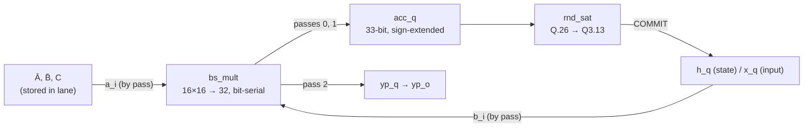

# DIMC-SSM: a bit-serial digital compute-in-memory lane for state-space models

A SystemVerilog accelerator core for **S4D state-space models (SSMs)**, aimed at always-on, millitwatt-class edge inference such as hearing aids and wearable sensors. The verified core is one **DIMC lane**: one SSM channel, weights held next to a bit-serial multiplier, computing one timestep in 56 cycles. It is bit-exact against a Python-based fixed-point **golden model** with **mutation testing** to validate the checks can fail.

| Block | Status |
|---|---|
| Python golden model (float + fixed-point Q3.13) and exported test vectors | ✅ Verified |
| C++ reference model (`ref::lane_step`), bit-exact vs Python | ✅ Verified |
| `bs_mult`: signed bit-serial multiplier | ✅ Verified (exhaustive at W = 4, 8) |
| `rnd_sat`: round-half-up + saturate requantiser | ✅ Verified (exhaustive at 12/4/6, RTL mutation-tested) |
| **`dimc_lane`: one SSM channel** | ✅ **Verified: 28,800 / 28,800 golden, 56/56-cycle latency** |
| `dimc_array`: 8 lanes, adder tree, D·x | Planned (see [Roadmap](#roadmap)) |
| CV-X-IF-style coprocessor interface | Scaffold only (valid/ready issue and result stages around a placeholder MAC); not yet connected to the DIMC |

Full verification evidence: [`docs/Verification.md`](docs/Verification.md).

---

## Why?
An SSM channel is a tiny recurrent filter:

$$
\begin{align}
h_k = \bar{A} \cdot h_{k-1} + \bar{B} \cdot x_k \\
y_k = \sum_c{C_c \cdot h_k[c]} + D \cdot x_k
\end{align}
$$
Unlike a transformer, an SSM needs no growing KV cache. Its memory is a fixed-size state so the cost per sample is constant which is far more suitable for continuous-inference edge devices with a milliwatt budget.

This therefore influences the design choices:
- **bit-serial arithmetic** - one 17-bit adder per multiplier instead of a full MAC
- **Weights-stationary storage** - Coefficients sit beside the compute and only the changing operand moves.


## The Lane
### Arithmetic Contract
All values are 16-bit **Q3.13**. Per timestep, per channel:

$$
\begin{align*}
\text{pass 0 : } & \text{acc = } \text{sext}(\bar{A} \cdot h_{k-1}) & \text{33-bit accumulator, Q.26} \\
\text{pass 1 : } & \text{acc += } \text{sext}(\bar{B} \cdot x_k) & \text{33-bit accumulator, Q.26} \\
\text{COMMIT : } & h_k = \text{sat16}((\text{acc} + 2^{12}) >>> 13) & \text{round half up then saturate} \\
\text{pass 2 : } & yp_k = C \cdot h_k & \text{33-bit accumulator, Q.26} \\
\end{align*}
$$

The array will compute '$y_k = \text{sat16} ( (\sum_c{yp_k[c]} + D\cdot x_k + 2^{12}) >>> 13)$', rounding once after the cross-channel sum.

### Datapath


One multiplier is reused for three passes. A pass counter (`pass_q`) selects both operands. It changes only on events: step accepts, pass 0 done and COMMIT. So the stored weight on `a_i` is gaurenteed stable for the whole multiply.

### Timing
Each pass is one START cycle plus Data Width (W) + 1 multiplier cycles. With an accept cycle and a COMMIT cycle, a timestep takes **3W + 8 = 56 cycles** at W = 16.

| Workload | Minimum clock |
|---|---|
| One step per 10 ms frame (golden-model rate) | 5.6 kHz |
| One step per sample at 16 kHz audio | 0.9 MHz |

At clock rates this low, leakage would be expected to dominate power instead of switching. This gives significant headroom for increasing the number of channel. The dominance of leakage power is why a small area is favoured over speed.

### Digital Compute-in-Memory
A lane is on row of a DIMC macro: the wieghts ($\bar A$, $\bar B$, $C$) are stored next to the compute and the streamed operand ($h$ or $x$) arrives one bit per cycle.

Hence, this is a *synthesisable DIMC* in the style of compiler-generated macros. Storage is flip-flops beside the logic, not a custom SRAM bitcell array.


## Verification
Each module is verified bottom-up against an independent golden-model. Details and every count are in [`docs/Verification.md`](docs/Verification.md).

| Level | Oracle | Result |
|---|---|---|
| Reference model | Python golden vectors | h 28,800/28,800, y 3,600/3,600 |
| `bs_mult` | Exhaustive signed products (W = 4, 8), corners + 10k random (W = 16) | 0 mismatches, latency W+1 on every product |
| `rnd_sat` | `ref::rnd_sat`; exhaustive at 12/4/6, directed + 100k random at 33/13/16 and 36/13/16 | 0 mismatches; RTL mutations R1–R4 all caught |
| `dimc_lane` | Hand maths, `ref::lane_step`, golden `h_trace`, and the identity yp = C·h | 39,428 steps, 0 mismatches, latency 56/56, 0 protocol violations |

The lane testbench drives and observes ports only:

| Test | What it covers |
|---|---|
| 1 | Hand-computed steps |
| 2 | Directed arithmetic corners (rounding ties, products ≥ 2¹⁵, all sign combinations) |
| 3 | All 8 golden channels, 3,600 steps each |
| 4 | Saturation: both rails, recovery, overflow sweep. The golden data never saturates. |
| 5 | 10k random steps |
| 6 | Handshake: one-cycle `out_valid`, inputs ignored while busy |

## Design Decisions

| Decision | Alternative | Why |
|---|---|---|
| Uniform Q3.13 (16-bit) | INT8 (Q2.5) | INT8 gave a max error of 1.888 against a 0.08 threshold (2 % of full scale). Near-unity poles amplify quantisation error by about 1/(1 − Ā), and those slow poles give an SSM its long memory. |
| Round half up | Truncate | Measured error 0.0028 vs 0.0082. Truncation's −0.5 LSB bias accumulates through the recurrence. |
| Saturate | Wrap | A bounded, predictable failure instead of a sign flip that silently corrupts the state. |
| One shared bit-serial multiplier, 3 passes | 3 parallel multipliers | One 17-bit adder instead of three. Latency is irrelevant at kHz step rates. |
| Separate START cycle per pass | Start the next pass on the done cycle | Costs 3 cycles per step. Operands are always settled when captured, which removes a class of mid-multiply bugs. |
| Separate COMMIT cycle | Bypass the new h straight into pass 2 | Costs 1 cycle per step. "Old h vs new h" can never mix within a step. |
| Writes accepted only in IDLE | Writes at any time | Guarantees the stored weight on `a_i` cannot change under a running multiply. |
| Add/subtract with one adder in `bs_mult` | A second carry chain for the final subtract | Conditional inversion plus carry-in: W + 1 XORs instead of another adder. |
| 33-bit accumulator | 34 bits | Tight bound: each product is at most 2³⁰ in magnitude, so the sum is at most 2³¹. |
| Directed edge-case tests alongside random tests | Random only | Mutation R1 lives in the top 2¹² of 2³³ inputs. 50k uniform samples catch it with only ≈ 2.4 % probability; the directed extremes catch it every time. |

The golden model's own decisions (S4D over Mamba, exact zero-order-hold discretisation, worst-case sizing over a 1-hour run) are in [`model/README.md`](model/README.md).

## Repository Layout

```
model/                Python golden model (float + fixed point), analysis, exported vectors
hw/pkg/dimc_pkg.sv    Shared widths: DATA_W, FRAC, LANE_ACC_W, ARRAY_ACC_W
hw/rtl/dimc/          bs_mult, rnd_sat, dimc_lane   <- the verified core
hw/rtl/cvxif/         CV-X-IF-style issue/result stages (scaffold)
hw/rtl/util/          Async FIFO (gray-code CDC), skid buffer
hw/rtl/mac/           Placeholder MAC behind the scaffold (to be replaced by dimc_array)
hw/tb/cpp/            Verilator C++ testbenches; ref/ holds the reference model and harness
docs/Verification.md  Verification plan, results and mutation testing
```

## Running the Repository

Prerequisites: Verilator, a C++20 compiler, GNU Make, and Python ≥ 3.10 with [uv](https://docs.astral.sh/uv/) for the model.

```sh
make model        # run the Python golden-model tests (regenerates vectors)
make ref_check    # C++ reference vs Python golden vectors
make sim_unit     # full regression: ref_check, dimc_lane, bs_mult (W = 4/8/16), rnd_sat (3 configs)

make unit UNIT=dimc_lane GPARAMS="DATA_W=16" WIDTH=lane TRACE=1   # one block, with an FST waveform
make wave         # open the waveform in Surfer
```

## Roadmap

1. **`dimc_array`:** 8 lanes, an adder tree over yp, D·x, and y requantisation. Needs a second golden vector set with D ≠ 0, because the current set has D = 0 and so cannot check the D·x path.
2. **Synthesis:** area, fmax and leakage for the lane and the array.
3. **CV-X-IF integration:** replace the placeholder MAC behind the issue/result stages with `dimc_array`, using a valid/ready handshake. Then co-simulate with a CV32E40X core.
4. **Numerics study:** per-signal formats (e.g. Ā as unsigned 0.16), word-length vs SQNR.
## Notes

AI tools were used during this project:
- `docs/Verification.md` summarises my verification notes and test logs;
- this README was drafted with AI assistance.
The architecture, RTL, golden model, and the analysis of results are my own.

## License

Solderpad Hardware License v2.1 (`Apache-2.0 WITH SHL-2.1`); see [`LICENSE.md`](LICENSE.md).
