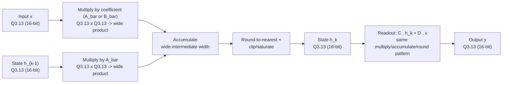

# SSM Golden Model - Design Decisions

This directory contains the *floating-point* and *fixed-point* golden model for core computation of an S4D architecture. This generates the bit-exact test vectors the RTL testbench verifies against. This README records the design decisions made during that phase and why.

## Architecture Choice
### S4D (diagonal, static/LTI), no Mamba selective scan
The recurrent core uses a per-channel diagonal `A` and which `A`, `B`, `C`, `D` are precomputed on the host and held fixed at runtime. This is different to the input-dependent selective mechanism seen in the more advanced Mamba. This was a deliberate scope decision, not a simplifcation by default:
- A diagonal, LTI `A` makes exact ZOH discretization affordable ($\bar{A} = \exp(A\Delta)$).
- Target application is edge sensor/audio processing. Mamba selectivity is computationally expensive and power hungry and so it's not necessary
- Future Proofing, with rapid development in SSM architectures targetting exact architecures would soon become antiquated. Hence, the focus is on the recurrent core that is foundational to all SSM computation.

## Numerics

| Decision | Choice | Rationale |
|---|---|---|
| Discretization | Exact ZOH: $\bar{A} = \exp{A\Delta}$, $\bar{B} = \frac{\bar{A}-1}{A} \cdot \cdot B'$ | Affordable because `A` is diagonal — no matrix exponential needed |
| Number format | Uniform `Q3.13` (16-bit: 1 sign + 2 integer + 13 fractional) | Single format across coefficients, state `h`, input `x`, output `y` — simplifies the datapath, no per-signal format bookkeeping |
| Overflow handling | Clip / saturate | Bounded, predictable failure mode vs. wraparound corrupting state silently |
| Rounding | Round-to-nearest | Measured error 0.0028 vs. 0.0082 for truncate; truncate also has a directional (downward) bias that compounds under long feedback — round-to-nearest doesn't |
| Output rescale | `y` explicitly rescaled from the wide multiply/accumulate result back down to `Q3.13` | Keeps intermediate precision during the MAC, then re-quantizes once at the boundary rather than truncating mid-computation |

## Worst-case Sizing

The state `h` and output `y` need enough headroom to never saturate under realistic operation without wasted precision.

- **Time-Frame**: 1-hour continuous-inference rest intervals
- **Validation**: Run 3-point duration sweep to confirm variable sizing, confirming growth decelerates within 1-hour mark.
- **Acceptance Threshold**: 2% of full-scale (currently met within margin)

## Data path width changes

## Test Vectors
`vectors/` contains the exported stimulus/expected-output paris (`x_seq_q`, `y_seq_q`, both `Q3.13`, round-to-nearest) that the Verilator C++ testbench compares against the RTL. Bit-exact match against these vectors is the pass/fail criterion for the bit-serial DIMC.
